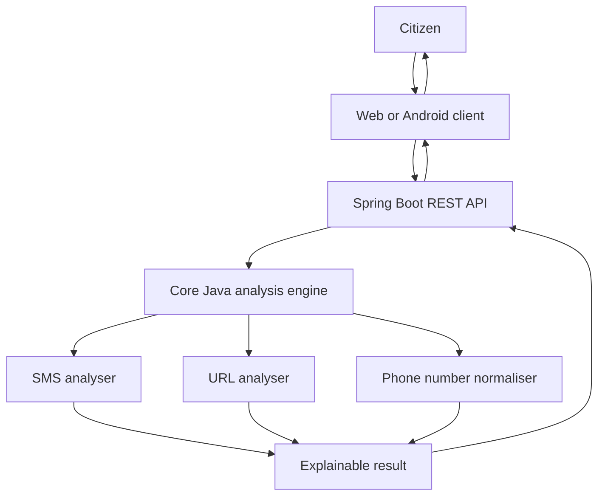

# Mana Suraksha 🛡️
### Bilingual digital-fraud awareness and protection platform

Mana Suraksha (మన సురక్ష) is a Java-based learning project that helps people inspect suspicious SMS messages, website links and phone-number formats, understand warning signs and learn safer next steps.

<details><summary><b>Project status — read before using</b></summary>

This is an early working prototype, not a production fraud-detection service. The Core Java SMS and URL rules, phone-number normaliser, Spring Boot analysis endpoints, starter browser interface and initial SQL schema are present. Rules are deliberately limited and have not been validated against real-world fraud datasets. Database persistence, authentication, reporting/moderation, trusted threat feeds, Telugu translations and Android are not implemented yet.

</details>

## What works in this repository now

| Feature | Current state |
|---|---|
| Core Java SMS analyser | Starter rules + JUnit tests |
| URL structure analyser | Local parsing checks; never opens URL |
| Indian phone normaliser | Input formatting/validation only |
| Spring Boot API | SMS, URL, phone and health endpoints |
| Web interface | Responsive starter UI wired to API |
| MySQL schema | Initial SQL design, not connected |
| Reports and moderation | Design only |
| Android app / call screening | Planned |

## How the application works



1. User chooses SMS, URL or phone check.
2. Client validates input and warns not to share secrets.
3. Spring Boot validates the JSON request.
4. Core Java performs the selected analysis.
5. API returns a structured result with findings, limitations and recommendations.
6. Client displays the result. A report workflow will be added separately; community reports will not automatically become verified threat intelligence.

## Run it locally

Requirements: **JDK 17+** and **Maven 3.8+**.

From the repository root:

```bash
mvn test
mvn -pl backend -am install
mvn -pl backend spring-boot:run
```

The API runs at `http://localhost:8080`. Health endpoint: `GET /api/v1/health`.

In another terminal:

```bash
cd web-app
python -m http.server 5500
```

Open `http://localhost:5500`. Local development CORS allows this origin for the analysis controller.

### API examples

SMS:
```bash
curl -X POST http://localhost:8080/api/v1/analysis/sms -H "Content-Type: application/json" -d '{"text":"Please share your OTP immediately"}'
```

URL:
```bash
curl -X POST http://localhost:8080/api/v1/analysis/url -H "Content-Type: application/json" -d '{"url":"http://192.0.2.10/login"}'
```

Phone:
```bash
curl -X POST http://localhost:8080/api/v1/analysis/phone -H "Content-Type: application/json" -d '{"phone":"98765 43210","countryCode":"+91"}'
```

## Repository structure

```text
Mana-Suraksha/
├── core-java/                 # Framework-independent Java domain and analyzers
│   └── src/
│       ├── main/java/         # Models, SMS, URL and phone logic
│       └── test/java/         # JUnit tests
├── backend/                   # Spring Boot REST API
│   └── src/main/java/         # Controllers and application entry point
├── web-app/                   # HTML, CSS and JavaScript client
├── android-app/               # Android client planned
├── database/                  # Initial MySQL schema
├── docs/                      # Product, architecture, API and workflow docs
└── .github/workflows/         # Core Java CI
```

## Documentation and workflow

- [End-to-end development workflow](docs/DEVELOPMENT_WORKFLOW.md)
- [Project workflow and user journeys](docs/PROJECT_WORKFLOW.md)
- [System design](docs/SYSTEM_DESIGN.md)
- [API contract](docs/API_DOCUMENTATION.md)
- [Database design](docs/DATABASE_DESIGN.md)
- [Security and privacy](docs/SECURITY_AND_PRIVACY.md)
- [Fraud detection logic](docs/FRAUD_DETECTION_LOGIC.md)
- [Testing strategy](docs/TESTING_STRATEGY.md)
- [Class diagram](docs/CLASS_DIAGRAM.md)
- [Phase 1 Core Java learning plan](docs/PHASE_1_CORE_JAVA_FOUNDATION.md)

## Product safety principles

- Never request or store OTPs, PINs, passwords or banking credentials.
- Never auto-open an untrusted URL.
- “No known threat” is not a guarantee of safety.
- A risk score is a policy score, not a probability.
- Caller ID can be spoofed; a phone number is not proof of caller identity.
- Community reports and independently verified indicators must remain separate.
- If a source is unavailable or stale, return an explicit unknown/incomplete state.

## Roadmap

- [x] Product workflow and architecture documented
- [x] Core Java SMS prototype and tests
- [x] Core Java URL structure checks and tests
- [x] Indian phone number normalisation and tests
- [x] Spring Boot analysis and health endpoints
- [x] Starter web interface
- [x] Initial MySQL schema
- [ ] Run full Maven build and verify CI
- [ ] Add robust Telugu/English localisation
- [ ] Add MySQL persistence and migrations
- [ ] Add authentication and authorisation
- [ ] Implement report submission and moderation
- [ ] Add trusted threat intelligence adapters
- [ ] Build Android app and test supported call-screening APIs
- [ ] Security, accessibility and real-world evaluation

## Interview explanation

“Mana Suraksha is a bilingual digital-safety platform. Its modular Java engine analyses suspicious SMS messages, URLs and phone-number reputation, then returns an explainable risk assessment. A Spring Boot backend exposes analysis and reporting APIs, MySQL stores report metadata and moderated threat indicators, and Android/web clients provide accessible interfaces. The design separates community reports from verified threat intelligence and prioritises privacy and false-positive prevention.”

**Interview honesty:** the current implementation is a starter prototype. Explain the working SMS, URL, phone-format and API code as implemented; explain database integration, reports, Android and production detection as planned work.

## Contributing

See [CONTRIBUTING.md](CONTRIBUTING.md). Use focused branches, add tests, run `mvn test`, review diffs and never commit secrets or private victim data.
