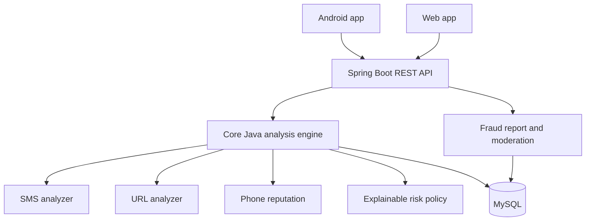

# Mana Suraksha 🛡️
### Bilingual digital-fraud awareness and protection platform

**Mana Suraksha** (మన సురక్ష) is a planned Telugu-and-English digital-safety platform to help people recognise suspicious SMS messages, phishing links and scam-call signals, report suspected fraud, and understand safer next steps.

> **Project status: Early foundation / in progress.** The repository contains the product blueprint, system design, database proposal and a small Core Java starter. Android, web and Spring Boot features are planned—not yet complete. Please treat all risk checks as educational prototypes until validated.

## Why this project?
Fraud messages often use urgency, impersonation, suspicious links or requests for OTPs and payments. People who are new to smartphones may find these messages difficult to evaluate. Mana Suraksha aims to explain warning signs in simple language instead of showing only a score.

## First-version scope
- **SMS safety:** inspect text deliberately shared or pasted by the user.
- **Link safety:** inspect URL structure without automatically opening the destination.
- **Call safety:** manually check phone-number reputation; explore Android call-screening only where supported and explicitly enabled by the user.
- **Fraud reports:** submit suspected incidents and follow moderation status.
- **Bilingual guidance:** Telugu and English explanations and safety instructions.
- **Web + Android:** accessible interfaces for mobile and desktop use.

## Design principles
1. Explain *why* an item is suspicious and what the user can do next.
2. “No known threat” does not mean “guaranteed safe”.
3. Separate independently verified indicators from community reports and unknown items.
4. Never ask for or store OTPs, PINs, passwords or banking credentials.
5. Do not auto-open untrusted links or execute their content.
6. Caller ID can be spoofed; a phone-number report is not proof of caller identity.
7. Minimise personal data and provide clear consent and retention rules.

## Proposed technology
| Layer | Technology |
|---|---|
| Core analysis | Java 17+, Maven, JUnit |
| Backend API | Java + Spring Boot |
| Database | MySQL |
| Android | Java-first Android application |
| Web | HTML, CSS, JavaScript |
| Source control | Git and GitHub |

The first architecture is a **modular monolith**, not microservices. The Core Java analysis domain is kept independent of Spring so it can be unit-tested and explained clearly.

## Architecture at a glance


## Repository map
```text
Mana-Suraksha/
├── core-java/                 # Framework-independent Java analysis engine
├── backend/                   # Planned Spring Boot REST API
├── android-app/               # Planned Android client
├── web-app/                   # Planned web client
├── database/                  # SQL schema and migrations
├── docs/                      # Workflow, design, API, security and testing docs
├── .github/workflows/         # CI checks
├── README.md
├── CONTRIBUTING.md
└── LICENSE
```

## Documentation
- [Project workflow and user journeys](docs/PROJECT_WORKFLOW.md)
- [System design and architecture](docs/SYSTEM_DESIGN.md)
- [Core Java Phase 1 plan](docs/PHASE_1_CORE_JAVA_FOUNDATION.md)
- [API contract proposal](docs/API_DOCUMENTATION.md)
- [Database design](docs/DATABASE_DESIGN.md)
- [Security and privacy](docs/SECURITY_AND_PRIVACY.md)
- [Fraud detection logic](docs/FRAUD_DETECTION_LOGIC.md)
- [Testing strategy](docs/TESTING_STRATEGY.md)
- [Class diagram](docs/CLASS_DIAGRAM.md)

## Build the Core Java module
Requirements: JDK 17 or later and Maven 3.8+.

```bash
cd core-java
mvn test
```

The initial SMS analyzer is a deliberately small educational rules prototype. It is not a production fraud detector and has not been validated against real-world datasets.

## Roadmap
- [x] Product scope and user workflows documented
- [x] Initial system architecture and data model documented
- [x] Core Java starter module added
- [ ] Expand and test SMS analysis rules
- [ ] Implement safe URL analysis
- [ ] Implement explainable risk aggregation
- [ ] Add phone reputation and report domain
- [ ] Build Spring Boot API and MySQL persistence
- [ ] Build web client
- [ ] Build Android client and validate platform permissions
- [ ] Security, accessibility, localisation and release testing

## Interview explanation
“Mana Suraksha is a bilingual digital-safety platform. Its modular Java engine analyses suspicious SMS messages, URLs and phone-number reputation, then returns an explainable risk assessment. A Spring Boot backend exposes analysis and reporting APIs, MySQL stores report metadata and moderated threat indicators, and Android/web clients provide accessible interfaces. The design separates community reports from verified threat intelligence and prioritises privacy and false-positive prevention.”

**Be accurate in interviews:** explain the blueprint as design work and describe only code that you have actually implemented and tested as completed.

## Contributing
See [CONTRIBUTING.md](CONTRIBUTING.md). Keep changes focused, add tests, never commit secrets or real victims' private data, and update docs when implementation changes.

---
*Built as a learning and portfolio project focused on Java, backend engineering, system design and digital safety.*
