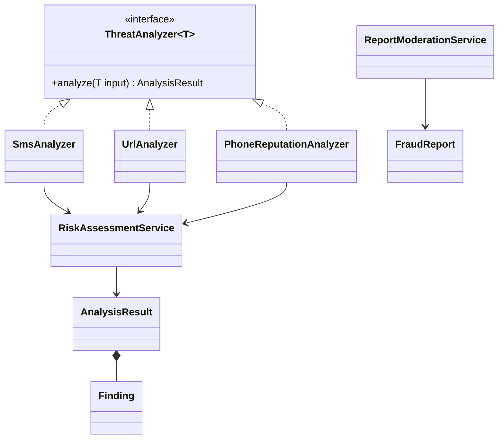

# Domain Class Diagram

Proposed relationships; not all classes are implemented yet.

Use composition to combine analyzers and findings. Keep domain objects independent of Spring controllers and database entities.
