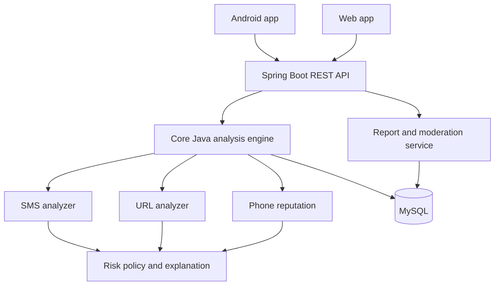
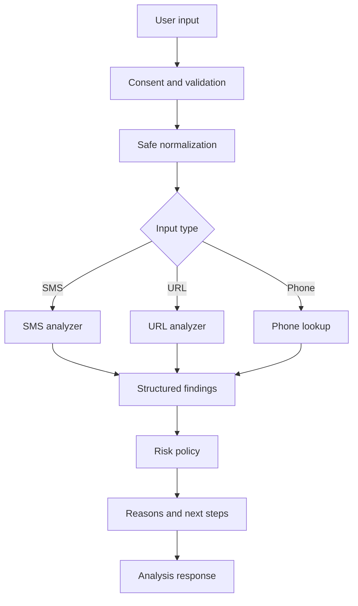

# System Design

**Status:** Proposed architecture. Update this document as implementation evolves. Stack: Java 17+, Maven, Spring Boot, MySQL, Android (Java-first) and HTML/CSS/JavaScript web client.

## Architecture

Start with a modular monolith, not microservices. Keep Core Java domain logic independent of Spring and database adapters.

## Layers
1. Presentation: Android and web clients.
2. API: Spring controllers, DTOs, validation, authentication and rate limits.
3. Application: AnalyzeSms, AnalyzeUrl, CheckPhone, SubmitReport and ReviewReport use cases.
4. Domain: analyzer contracts, findings, risk policy and report state machine.
5. Infrastructure: repositories, MySQL, external intelligence adapters, logging and private evidence storage.

## Core domain
| Type | Responsibility |
|---|---|
| ThreatAnalyzer<T> | Common analyzer contract |
| SmsAnalyzer | Extract SMS indicators |
| UrlAnalyzer | Parse URL without visiting it |
| PhoneReputationAnalyzer | Query approved reputation |
| RiskAssessmentService | Apply risk policy |
| AnalysisResult | Risk, score, reasons, recommendations and limitations |
| ThreatIndicator | Sourced, time-bounded threat signal |
| FraudReport | User-submitted report |
| ReportModerationService | Review and state transitions |

Use composition, interfaces, enums and immutable result objects. Suggested enums: RiskLevel (LOW, SUSPICIOUS, HIGH, UNKNOWN), VerificationStatus (VERIFIED, COMMUNITY_REPORTED, UNVERIFIED, UNKNOWN), ReportStatus (SUBMITTED, UNDER_REVIEW, NEEDS_INFORMATION, VERIFIED, UNVERIFIED, DUPLICATE, CLOSED).

## Analysis pipeline

SMS rules can inspect urgency, impersonation, OTP/credential disclosure requests, payment pressure and suspicious contact details. Context matters: a keyword match alone is not proof.

URL checks inspect scheme, hostname, punycode/IDN, lookalikes, misleading subdomains, IP-literal hosts and user-info fields. Do not fetch or execute URLs in v1. A future fetcher needs an isolated environment and SSRF, DNS rebinding, private-IP and redirect protections.

Phone checks show source and last-verified time. Caller ID can be spoofed; a number reputation is not proof of caller identity.

## Risk policy
Illustrative thresholds only; calibrate against labelled data and measure false positives/negatives.
| Score | Display |
|---|---|
| 0–29 | No known threat / low indicators |
| 30–69 | Suspicious |
| 70–100 | High risk |

Always support UNKNOWN / UNABLE_TO_CHECK. A score is a policy output, not a probability. Community reports have lower confidence than independently verified indicators. Record policy version, rule codes, source freshness and limitations.

## Data model
Users, roles, user_roles, analysis_history, analysis_findings, threat_indicators, fraud_reports, report_evidence, report_votes, moderation_actions and audit_events. See DATABASE_DESIGN.md and database/schema.sql.

## API proposal
Base path /api/v1:
- POST /analysis/sms
- POST /analysis/url
- POST /analysis/phone
- POST /reports
- GET /reports/{reportId}
- GET /reports/mine
- POST /reports/{reportId}/evidence
- GET /safety-guides/{guideCode}
- GET /moderation/reports
- PATCH /moderation/reports/{reportId}

Use DTOs, validation, consistent errors, ownership checks, role checks and rate limits. Never log raw request bodies.

## Security and privacy
Never request OTPs, PINs, passwords, card data or banking credentials. Avoid storing raw SMS and full URLs. Use TLS, least privilege, parameterised queries, secure authentication, private evidence storage and audit trails. Separate community reports from verified indicators and provide expiry/appeal. Provider failures must return an explicit unknown/incomplete result.

## Interview walkthrough
Explain the clients, REST API, Core Java analyzer interface, composition, enums, collections, exception handling, MySQL relationships, transactions and security. Be clear about implemented versus designed features. A modular monolith is easier to build, test and explain than premature microservices.
